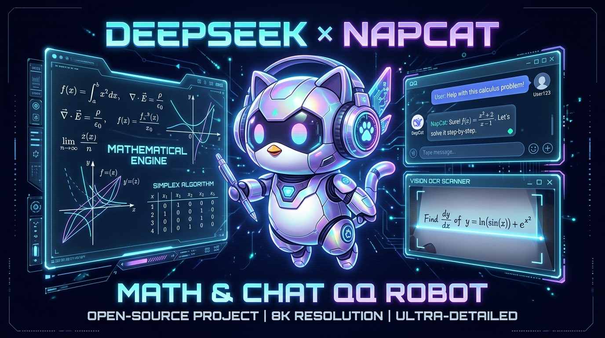

# 基于 NapCat + DeepSeek Harness 开发数学答疑与陪聊 QQ 机器人

<p align="center">
  
</p>

<p align="center">
  
  
  
  
  
</p>

> 一个**真实上线运行**的 QQ 群机器人完整案例：从买服务器、装 NapCat、写代码，到能识图批改、画单纯形表、画函数图像、出 PDF。
>
> 全部踩过的坑、全部可复制的命令、全部提示词原文都在这个文件夹里。

---

## 📖 文档导读

| 文档 | 规模 | 内容 | 适合谁看 |
|---|---|---|---|
| **[01-实战全记录.md](01-实战全记录.md)** | 1102 行 | **主文档**。阿里云新人代金券怎么拿、服务器怎么配、Windows 为什么必须换 Linux、NapCat 怎么装、代码架构、五级 API 降级、运维体系、安全设计、实测数据、完整时间线 | 想从零复刻一套的人 |
| **[02-能力迭代史.md](02-能力迭代史.md)** | 1243 行 | 数学解题能力怎么一步步长出来的：**纯文字 → 出 PDF → 识图批改 → 画表格 → 画函数图**，每一步的问题、根因、修法、代价 | 关心"能力怎么渐进增强"的人 |
| **[03-踩坑与排查手册.md](03-踩坑与排查手册.md)** | 2567 行 | **26 个坑 + 8 条通用教训**，按「症状 → 根因 → 修法 → 验证 → 教训」组织，含服务器/NapCat/代码逻辑，以及**最有价值的排查手法一章** | 正在踩坑、需要急救的人 |
| **[04-提示词与人格设计.md](04-提示词与人格设计.md)** | 977 行 | 提示词工程：PERSONA / OUTPUT_RULES / PDF_HINT / IMAGE_HINT **四段完整原文 + 逐条设计解读**，含输出协议与 `_normalize()` 防御 | 想直接复用这套提示词的人 |
| **[05-服务器配置详单.md](05-服务器配置详单.md)** | 精确到能照着再买一台：实例规格、CPU/内存/磁盘/网络的实际值、软件栈版本、目录端口、计费、**以及每一条的复核命令** | 要重建服务器 / 排查环境问题的人 |
| **[06-接手续开发记录-ZCode.md](06-接手续开发记录-ZCode.md)** | DSH 交接后 ZCode 的增量开发：**单纯形表算术自检**（格式对 → 数字也可验证）、**PDF→MD 转换器**（逐页覆盖率自检兜底）、**PDF 解题任务**（群友引用 PDF + @机器人 → 解题 → PDF 发回，MD 缓存半小时）、方法论技能文档；含全部新坑修法与**换服务器增量重建清单** | 接手维护 / 换服务器重建的人 |
| **[07-交接文档-脱敏版.md](07-交接文档-脱敏版.md)** | DSH 交接文档的公开化改写：服务器概况、**六条绝对不能做的事（红线）**、车主规矩、待办状态、常用命令。**新接手的 AI/人从这里开始读**，接手后的增量见 06 | 接手项目的人（第一份要读的） |

> 📌 **文档里的公网 IP、QQ 号、群号、API key 全部已替换为占位符**，可以直接公开。
> 代码副本在 `code/`，`.env` 未包含（只有 `.env.example` 模板）。

---

## 🚀 快速开始

如果你只想跑起来，按这个顺序：

```bash
# ── 1. 准备一台 Linux 云服务器 ──────────────────────────
#    2 核 4G 起步，Ubuntu 24.04，中国大陆地域
#    ⚠️ 千万不要选 Windows

# ── 2. 装系统依赖 + LaTeX（约 2G，10 分钟）──────────────
apt-get update && apt-get install -y \
  python3-venv git curl unzip screen xvfb g++ fontconfig \
  --no-install-recommends
apt-get install -y --no-install-recommends \
  texlive-latex-base texlive-latex-recommended texlive-latex-extra \
  texlive-xetex texlive-lang-chinese texlive-fonts-recommended \
  ghostscript poppler-utils fonts-noto-cjk

# ── 3. 装 NapCat（用代理绕过 GitHub 慢）─────────────────
curl -s 'https://gh-proxy.com/https://raw.githubusercontent.com/NapNeko/napcat-linux-installer/main/install.sh' -o install.sh
bash install.sh --github-proxy https://gh-proxy.com

# ── 4. 删掉 type:module（不删起不来！）──────────────────
python3 -c "import json;p='napcat/package.json';d=json.load(open(p));d.pop('type',None);json.dump(d,open(p,'w'),indent=2)"

# ── 5. 部署机器人 ──────────────────────────────────────
cp code/server/.env.example code/server/.env
vim code/server/.env          # 填 BOT_QQ / 群号 / API key / OneBot token
bash code/server/deploy.sh

# ── 6. 扫码登录 QQ ────────────────────────────────────
#    二维码在 napcat.log 或 napcat/cache/qrcode.png
#    ⚠️ 配置要在扫码前写好，只扫一次

# ── 7. 启动 ────────────────────────────────────────────
systemctl start qqbot
```

**⚠️ 强烈建议先读 [01-实战全记录.md](01-实战全记录.md) 的「必须提前知道的 10 件事」**，
里面每一条都是真金白银换来的——尤其是"配置要在扫码前写好"这一条，否则你要反复扫码，
每次都增加腾讯风控风险。

---

## 🗂 代码结构

```
code/
├── server/                 机器人代码（部署到 /home/qqbot/qq-bot/）
│   ├── main.py             主循环 / 触发判断 / 分段发送
│   ├── brain.py            调 LLM + JSON 输出协议 + 五级线路降级
│   ├── persona.py          人格与输出协议（提示词唯一来源，含转义自检）
│   ├── vision.py           取图 + 回溯引用消息里的图
│   ├── latexrender.py      LaTeX 渲染包装（实际编译调 latex/render.py）
│   ├── media.py            表情包轮换
│   ├── humanize.py         拟人化节奏（打字延迟、分段发送）
│   ├── rampup.py           融入群聊时间表
│   ├── onebot.py           OneBot 11 客户端
│   ├── config.py           配置加载
│   ├── spend.py            服务器额度估算
│   ├── probe_relay.py      中转站探测工具
│   ├── healthcheck.sh      健康检查 + 流量护栏（cron 每 5 分钟）
│   ├── backup.sh           自动备份（cron 每 6 小时）
│   ├── deploy.sh           一键部署
│   ├── qqbot.service       systemd 单元
│   ├── napcat.service      systemd 单元
│   └── .env.example        配置模板
├── latex/                  LaTeX 渲染管道
│   ├── render.py           编译器（安全过滤 + 文件锁串行队列）
│   ├── template_card.tex   公式卡片模板（出图片）
│   └── template_doc.tex    多页推导模板（出 PDF）
├── tools/
│   └── show_providers.py   查看所有 API 线路与余额
├── stickers/               表情包素材（7 张，可自行替换）
└── 机器人运维手册.md        日常运维速查
```

**核心模块只有 7 个**，职责清晰：

| 模块 | 一句话 |
|---|---|
| `main.py` | 从 NapCat 拿消息 → 判断要不要回 → 把回复发出去 |
| `brain.py` | 问 LLM"这条要不要接、怎么接"，解析它的 JSON 回复 |
| `persona.py` | 告诉 LLM"你是谁、该怎么说话"（**改人格改这里**） |
| `vision.py` | 把图取出来喂给 LLM（含从引用消息里回溯） |
| `latexrender.py` + `latex/` | 把 LaTeX 编译成图片或 PDF |
| `humanize.py` | 让它别秒回、别一次发一大段（**像人的关键**） |
| `media.py` | 表情包轮流发 |

---

## ✨ 它最终能做什么

| 能力 | 说明 |
|---|---|
| **点名答疑** | 被 @ 必回。答不上来也会接一句，绝不冷场 |
| **闲聊参与** | 活跃参与模式：**约 6 条/小时**（群里另一个机器人 muse 是 9.4），有自己的风格 |
| **看图批改** | 群友引用一张解题截图并 @ 它 → 它能读出推导、逐步核对、指出错在哪一步 |
| **出 PDF** | 中文讲解 + 公式排版成 PDF，文件名按任务类型自动起 |
| **画单纯形表** | 运筹学/线性规划，booktabs 三线表，C_B / X_B / b / θ / σ_j 列全 |
| **画函数图** | TikZ + PGFPlots，函数图像、几何图、曲线间面积填充 |
| **发公式图** | 单步公式渲染成紧凑图片，1 秒出图 |
| **收尾 @ 提问者** | 发完文件后单独 @ 对方，而且会点出具体结论 |
| **发表情包** | 素材轮换，冷场救场 |
| **五级 API 降级** | 前面的线路挂了自动换下一条，用户完全无感 |

**一个真实的能力展示**：给一张最后一步符号写反的分部积分图，它的回应是——

> 结论：最后一行符号错了。你写的是 $xe^x + e^x + C$，但前面那个减号要一直带下来，应该凑成 $-e^x$。
>
> 验算一下更保险：对 $xe^x - e^x$ 求导，得 $(e^x + xe^x) - e^x = xe^x$，和原被积函数一致。
> 而你的答案求导会多出 $2e^x$，显然不对。
>
> 总评：方法全对，只栽在最后一步的符号上，可惜。

**它不但认出来了，还自己求导验算了一遍来证明错在哪。**

---

## 📊 关键数据

### 服务器（阿里云 ECS）

| 项 | 值 |
|---|---|
| **实例规格** | **`ecs.e-c1m2.large`** |
| **CPU** | **2 vCPU**（Intel Xeon Platinum @ 2.5 GHz，1 物理核 × 2 线程，KVM） |
| **内存** | **4 GiB**（系统内可用 3.54 GiB，差额是内核保留）+ 2 GiB swap |
| **系统盘** | **40 GiB** 云盘（ext4，已用 7.4 GiB / 20%） |
| **操作系统** | **Ubuntu 24.04.5 LTS**（代号 noble），内核 6.8.0-139 |
| **地域** | 华东1（杭州）`cn-hangzhou`，可用区 H |
| **带宽** | 100 Mbps 峰值，**按使用流量**计费（唯一爆炸风险） |
| **成本** | **¥0.254 / 小时**（≈ ¥6.1/天 ≈ ¥183/月），用新人 ¥300 代金券抵扣 |

> ⚠️ **最容易记错的两点**：是 **2 核 4G**（不是 2G 4核）、**Ubuntu 24.04**（不是 24.0）。
> 精确值 + 复核命令见 [05-服务器配置详单.md](05-服务器配置详单.md)。

### 运行占用

| 项 | 数值 |
|---|---|
| 内存已用 | 802 MiB / 3.5 GiB（**22%**），swap 用了 **0 B** |
| QQ（NapCat）占内存 | 886 MiB（**已用的 87%**，省不掉） |
| 机器人自身占内存 | **30 MiB**（峰值 38） |
| LaTeX 渲染峰值 | 178 MiB，耗时 0.3 ~ 1.7 秒 |
| LLM 消耗 | ≈ **¥0.37/天**（受益于 DeepSeek 上下文缓存） |
| 单张公式图 | 0.7 ~ 1.4 秒 |
| 用户感知回复延迟 | 5 ~ 15 秒（含刻意的拟人停顿） |
| Python 依赖 | **只有 requests + Pillow** —— 没有框架、没有数据库、没有 Web 服务 |

---

## ⚠️ 五条最容易致命的经验

1. **云服务器一律选 Linux，不要 Windows。** 机器人不需要图形界面，而 Windows 自身就吃掉一半内存，还无法自动化操作。

2. **NapCat 的 `package.json` 必须删掉 `"type": "module"`。** 一行的事，但不删就是起不来（ESM/CommonJS 冲突）。

3. **OneBot 配置必须在第一次扫码之前写好。** 改配置 = 重启 = 掉登录 = 重新扫码，而每次扫码都增加腾讯风控风险。配置文件写 `onebot11_<QQ号>.json`，再复制一份 `onebot11.json` 双保险。

4. **LaTeX 编译要当不可信代码对待。** 你是在把模型输出丢进编译器。必须 `-no-shell-escape` + 危险宏黑名单 + 超时 + 非 root 用户 + 隔离目录，一个都不能少。

5. **按量流量计费没有上限。** 100Mbps 峰值跑满一天能烧掉几百块。必须加本地流量护栏 + 云厂商额度预警。

---

## 🔒 安全说明

本文件夹的代码**已剔除所有真实密钥**：

- `.env` 未包含（只有 `.env.example` 模板）
- 代码中出现的 `sk-你的令牌` 均为占位符
- 部署前请自行填写 `.env`

⚠️ **请务必自行设置**（`.env` 部署后权限设 600）：

```bash
chmod 600 .env
```

---

## 📝 关于这份文档

所有内容来自一个**真实运行中**的项目，不是教程抄录。文档里的每个坑都实际踩过，
每条命令都实际跑过，每个数据都是实测值。

如果你在复刻过程中遇到文档没覆盖的问题，大概率能在
[03-踩坑与排查手册.md](03-踩坑与排查手册.md) 的「排查手法」一节找到思路——
那一节讲的不是"这个 bug 怎么修"，而是**"遇到没见过的 bug 该怎么查"**。

---

## 附：项目教给我的三件事

1. **静默失败比崩溃危险得多。** `except: pass` 会把"功能没生效"伪装成"功能正常"；提示词里少一个反斜杠，模型就悄悄读到垃圾还照着做。**能炸就让它炸。**

2. **"能跑"和"跑对了"是两码事。** 回复流畅不代表答得对；表格好看不代表数字是对的。

3. **写死的值迟早和现实脱节。** 写死的名字、写死的单价、写死的数量、写死的触发规则——**能算就别写死，能配置就别硬编码。**
